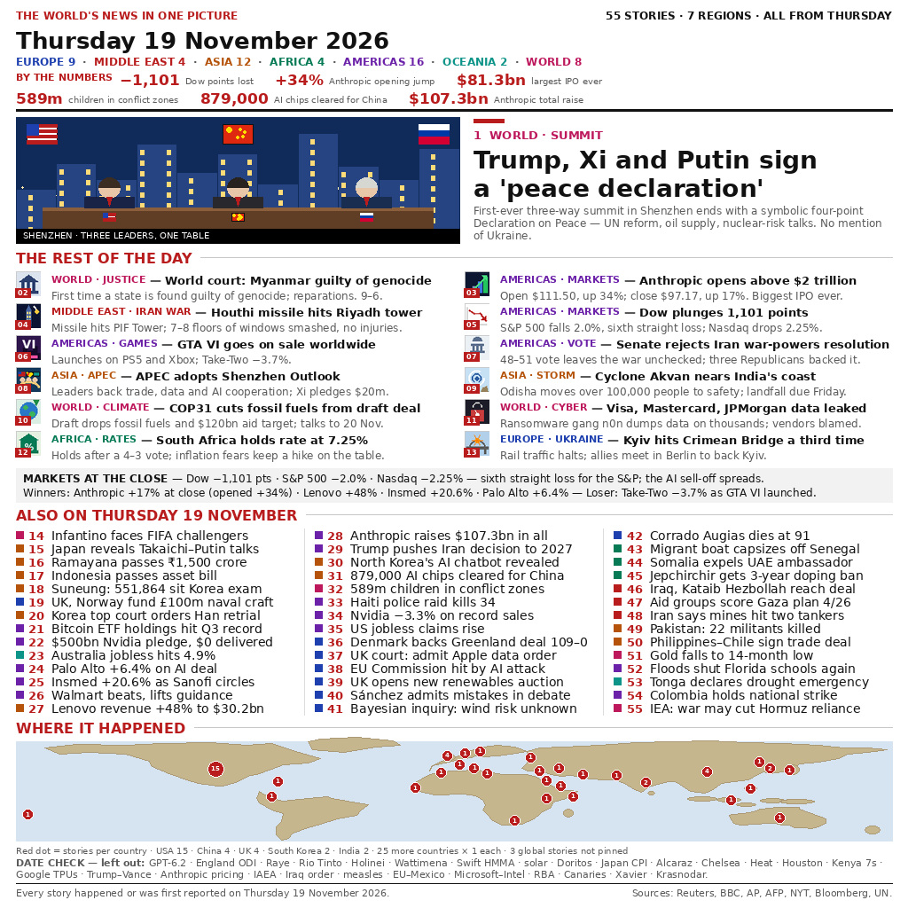

# Thursday 19 November 2026 — the world's news in one picture

[](https://make.fun/bounty/news-image-20261119?utm_source=github&utm_medium=readme&utm_campaign=news-image-20261119)
[](https://make.fun/bounty/news-image-20261119/leaderboard?utm_source=github&utm_medium=readme&utm_campaign=news-image-20261119)
[](https://make.fun/bounty/news-image-20261119?utm_source=github&utm_medium=readme&utm_campaign=news-image-20261119)

One 1024×1024 magazine-style page that sums up Thursday 19 November 2026:
**55 stories** — 1 hero story with a drawn diagram (the Shenzhen summit),
a 12-story river in 2 columns where **every story has a small original
illustration**, a markets strip, a DATE CHECK footer note, a 42-item ALSO
list in 3 columns with region dots, and a **"WHERE IT HAPPENED" world map**
with a numbered pin per country (USA 15, China 4, UK 4, South Korea 2,
India 2, 25 more × 1; 3 global stories not pinned), all in large,
readable type. Every story happened or was first reported on 19 November
2026; items from other days are listed only in the DATE CHECK note, marked
as left out on purpose.



## Run it

```sh
python3 main.py   # writes entry.png to $MAKEFUN_OUTPUT_DIR, /output, ./output or tmp
python3 gen.py    # regenerates entry.png + preview-300.png in place
```

Deterministic, stdlib-only (plus Pillow), no network. Two runs produce
byte-identical PNGs — verified SHA-256 (v5, 20 Nov 2026):
`6f61d15c5b2d24e903faf50b9ab643953b00f2041ae03838d332cc016b01442c`

v5 is a visual revision only (content frozen at v4, per the user's
11:18 WIB request): 12 original code-drawn illustrations for stories
1–13 (hero summit diagram + 28px thumbnails for the river), a
code-drawn world map with per-country story counts, river summaries
condensed to one line each with facts and numbers unchanged, and the
#2 headline shortened to fit ("guilty of genocide"). The map is a
simplified full-width locator strip — a 2:1 map would need ~450px of
height and crowd out ALSO.

v4 re-audits every story against the two top entries and primary
sources, plus the mock-judge verdict on v3: 5 more misdated stories
replaced (IAEA, Iraq order, measles, EU–Mexico, Microsoft–Intel),
the Gaza raid corrected (it ENDED on 19 Nov), the COP31 $120bn
clarified (removed from the 19 Nov draft), Nvidia fixed to −3.3%
on Thursday, Dow to −1,101 exactly, and the river rebalanced
further (Americas 16, Asia 12, Europe 9, World 8, Middle East 4,
Africa 4, Oceania 2) with Cyclone Akvan promoted in.

See [NOTES.md](NOTES.md) for the full story list, sources, and method.
